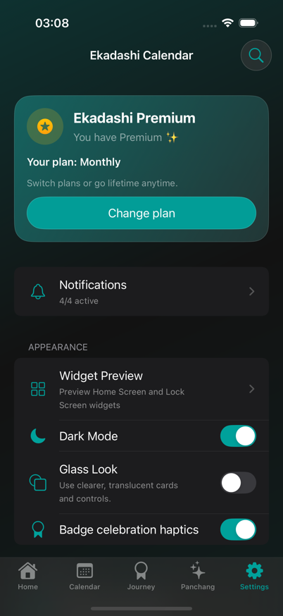
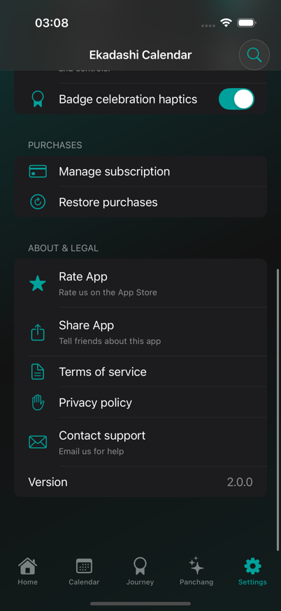
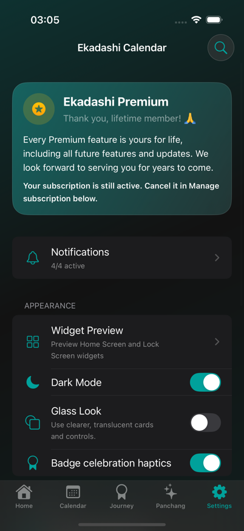
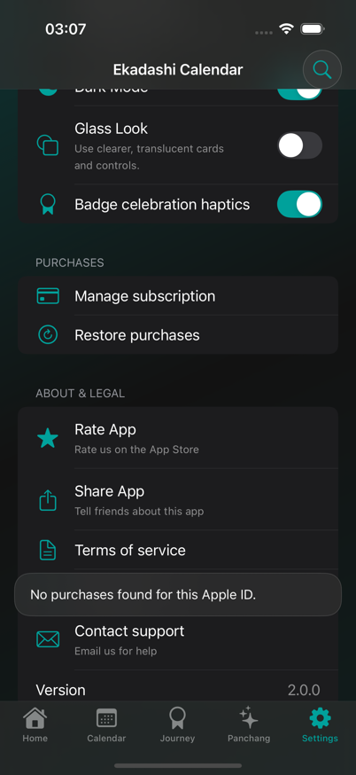
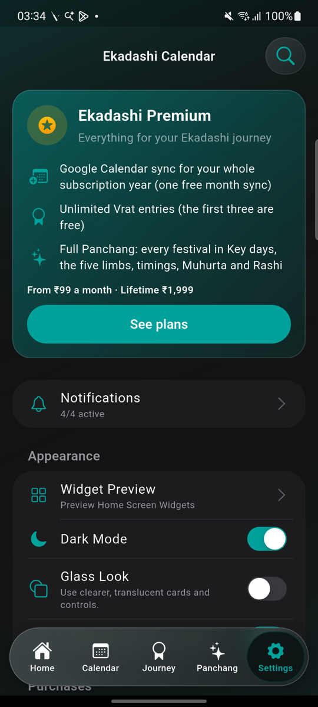
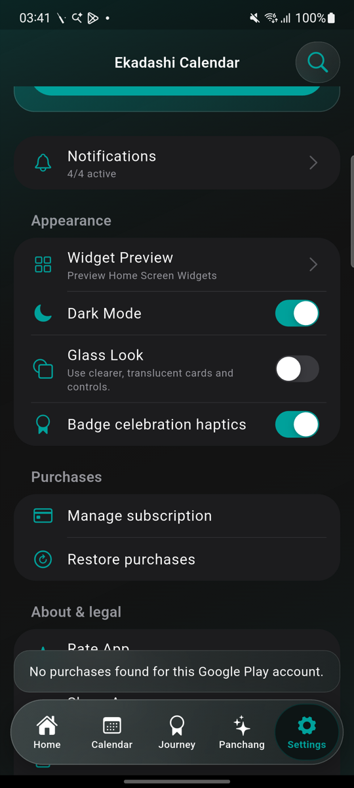
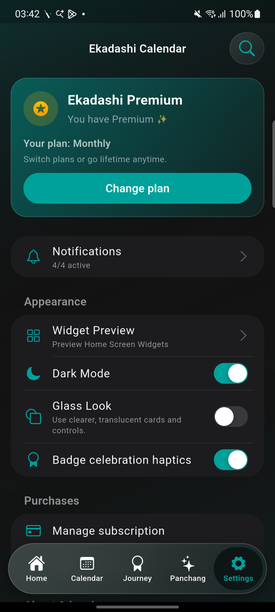
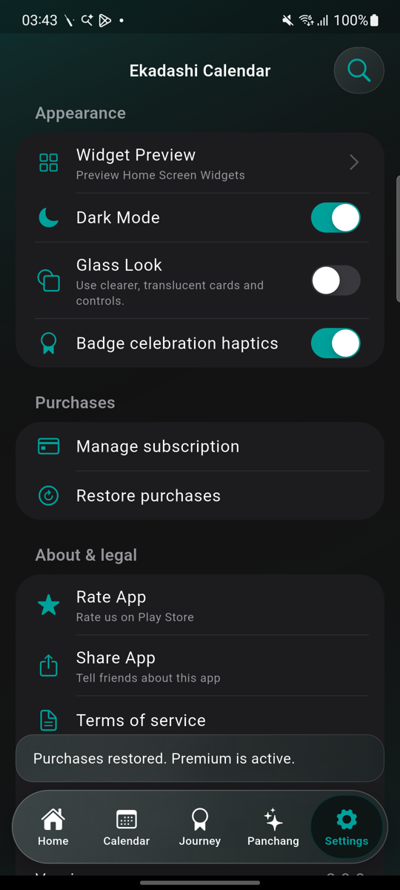
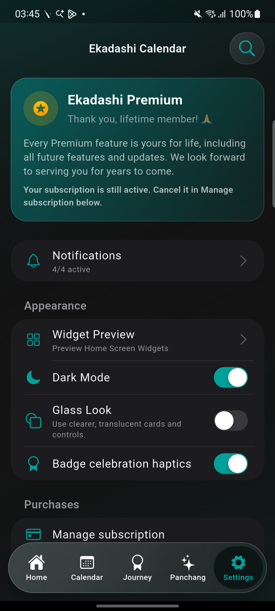
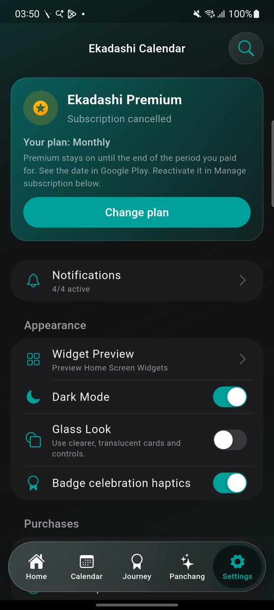

# Settings Purchases section: test report (27 Nov 2026)

Branch `claude/app-store-link`. Approved by Arun on 27 Nov 2026.

## What changed

- **Purchases** is a new Settings section, between Appearance and About & legal, on both apps. Every user sees the same two rows, with no notes or dates:
  - **Manage subscription** opens Apple's subscriptions sheet on iOS. On Android it opens the subscription's Google Play page, or Google Play's list of subscriptions when there is none.
  - **Restore purchases**.
- **The Premium card has no Manage button.** It keeps one main action, and its notes point to Manage subscription below:

  | Who | Card |
  |---|---|
  | Free | See plans |
  | Subscriber | Change plan |
  | Cancelled | Change plan; the text ends "Reactivate it in Manage subscription below." |
  | Payment problem (iOS) | "Update your payment method in Manage subscription below to restore Premium." |
  | Lifetime only | Thank-you message, no buttons |
  | Lifetime with a renewing subscription | Thank-you message plus "Your subscription is still active. Cancel it in Manage subscription below." |

- **The plans page is unchanged.**
- **The real App Store link is always used** on iOS: `https://apps.apple.com/app/id6825791305`.
- **`flutter analyze` skips the store screenshot helpers** in `store-assets/`.

## iOS simulator (UI tests)

| Subscriber card | Purchases | Lifetime + subscription | Restore (free) |
|---|---|---|---|
|  |  |  |  |

## Android on the M52 (release build 2.0.0 (14), license tester, test card)

| Free | Restore (free) | Subscriber | Restore (subscriber) | Lifetime + Monthly | Cancelled |
|---|---|---|---|---|---|
|  |  |  |  |  |  |

### Also checked on the M52

- **Manage subscription for a free user:** it now opens Google Play's list of subscriptions. Before the fix (`a8d63c8`) it opened the page of the old combined subscription, which said "We couldn't find your subscription". A test reproduced this before the fix.
- **Manage subscription for a subscriber:** it opens the Monthly's Google Play page.
- **Lifetime with a cancelled Monthly:** no note.
- **Test Lifetime order:** refunded and revoked with `tool/release/play.py refund`, and the account is back to free.

## Not run

- Nothing ran on Arun's iPhone. He was asleep; the build is installed for him to try.
- No CI (every commit carries `[skip ci]`).
